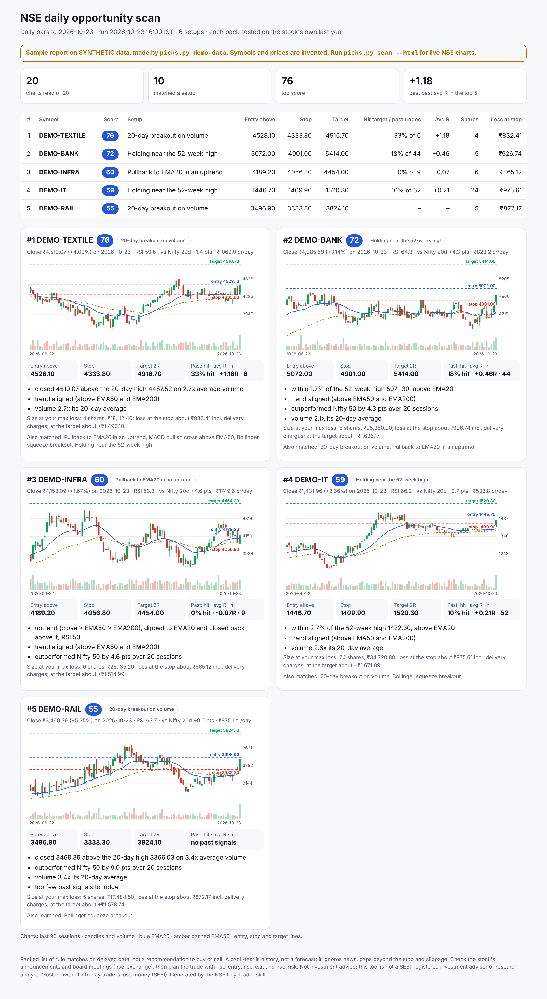
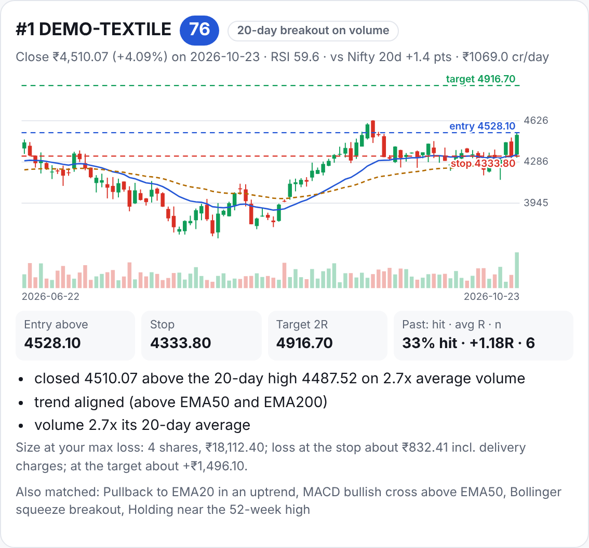
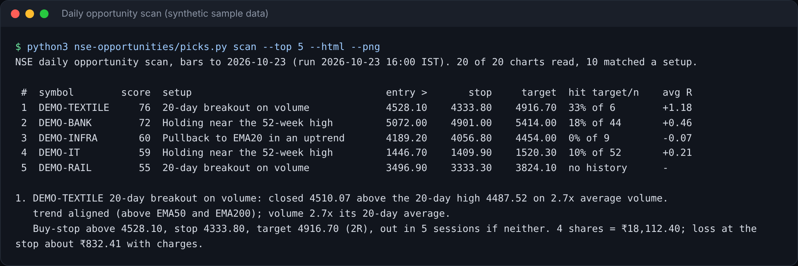
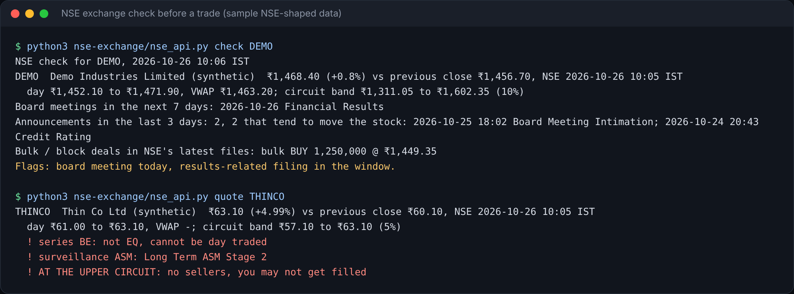
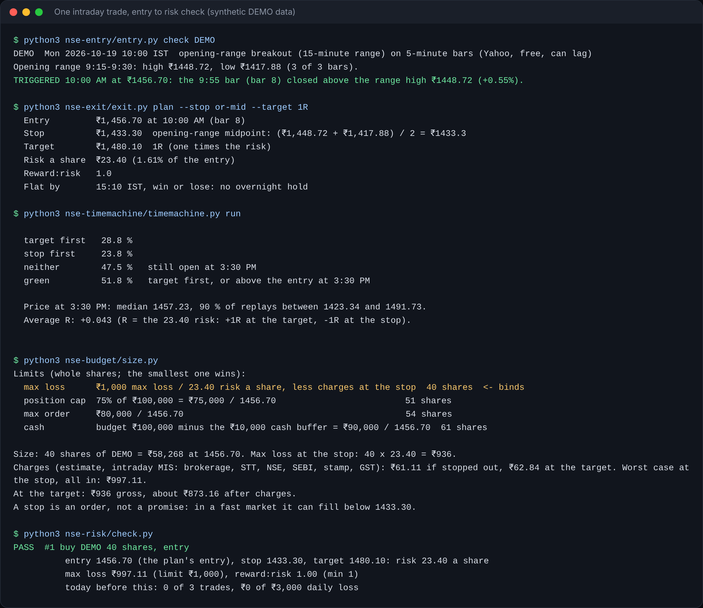

# NSE Day Trader skill

**Every trading day, Claude reads the charts of a whole NSE index, tests six
technical setups on each one, back-tests every match on that stock's own last
year, and hands you a ranked shortlist with entry, stop, target, position
size after charges, and a chart. Then it checks the exchange for anything
that could sink the trade, plans it, sizes it, and builds the Zerodha Kite
order. It places nothing without your yes.**

Eleven Claude skills, plain Python, no API keys.



<sub>Sample report on **synthetic** data (`picks.py demo-data`): the symbols
and prices are invented so the repo can show the output without
republishing exchange data. On your machine, `picks.py scan --html` builds
the same report from live NSE charts.</sub>

## What a trader gets each morning

| | |
| --- | --- |
|  | **One card per opportunity.** Why it matched (the rule, in words), what else lines up (trend, strength against the Nifty 50, volume), the plan (buy-stop entry, stop, 2R target, 5-session time stop, all on NSE ticks), the size that keeps the loss at the stop inside your max loss **including delivery charges**, and the honest back-test: how often this exact setup hit its target on this stock in the last year, and the average result in R. |

The six setups: 20-day breakout on volume · pullback to EMA20 in an uptrend
· MACD bullish cross · Bollinger squeeze breakout · holding near the 52-week
high · oversold bounce. Each is scored 0 to 100 on setup quality, trend,
relative strength, volume and its own back-test, with penalties for thin
trading, a wide range or a stretched RSI.



## Before you trade it: the exchange check

Charts don't know about this afternoon's board meeting. `nse-exchange` reads
NSE's own website data: market status, the official holiday calendar, the
stock's circuit band, series and surveillance status, corporate announcements,
board meetings and bulk / block deals. `nse-risk` then blocks what can't be
day traded and warns about the rest.



## Intraday: one trade, start to finish

Opening-range breakout on the IST clock, a stop and target on NSE ticks, 10,000
replays of the rest of the session from the stock's own bars, sizing in rupees
net of STT and charges, and a risk check, including a **SEBI insider-trading
guard** that always blocks stocks where you are a designated person.



## The eleven skills

| command | job |
| --- | --- |
| `/nse-opportunities` | **Daily scan:** six setups across an index, per-stock back-test, score, plan, size, HTML report with charts and PNG |
| `/nse-exchange` | **NSE data:** market status, holiday calendar, quote with circuit band and ASM / GSM, announcements, board meetings, bulk / block deals |
| `/nse-scanner` | Intraday opening-range breakouts across a list, plus pre-market daily setups |
| `/nse-news` | New headlines per stock, tagged (results, promoter, SEBI, circuit, RBI...) |
| `/nse-entry` | Watches a setup bar by bar and says the moment the breakout bar closes |
| `/nse-exit` | Stop and target on NSE ticks before you enter; flat by 15:10 |
| `/nse-timemachine` | Replays the rest of the day 10,000 times, plus every past day the rule fired |
| `/nse-budget` | Shares for your rupee budget and max loss, net of charges |
| `/nse-risk` | PASS or BLOCK: limits, window, SEBI PIT list, series, surveillance, circuits |
| `/nse-broker` | Zerodha Kite order calls (MIS BUY, then SL-M), paper by default, your yes required |
| `/nse-alerts` | Stop, target, flat-by and the 9:15 bell, on NSE's calendar |

```
every day:   nse-opportunities  ->  nse-exchange check  ->  nse-news
one trade:   nse-entry -> nse-exit -> nse-timemachine -> nse-budget -> nse-risk -> nse-broker
while open:  nse-alerts (stop, target, flat by 15:10)
```

## Install

Claude Code, as a plugin:

```
/plugin marketplace add parinshahAIbuilder/nse-day-trader-skill
/plugin install nse-day-trader-skill@nse-day-trader-skill
```

Or copy the folders into your skills directory:

```bash
git clone https://github.com/parinshahAIbuilder/nse-day-trader-skill.git
cp -r nse-day-trader-skill/nse-* ~/.claude/skills/
```

Python 3.8+, standard library only (`--png` screenshots use Playwright if
installed). Copy `nse-budget/config.example.json` to `trader/config.json` and
set your budget, limits and `pit_restricted` list. Then ask Claude:
*"run today's NSE opportunity scan on the Nifty 100 and show me the report"*.

## What changed from the US original

| | US original | NSE edition |
| --- | --- | --- |
| Session | 9:30 to 16:00 ET, DST | 9:15 to 15:30 IST; NSE holiday calendar, live from NSE |
| Symbols | TSLA | RELIANCE, M&M, BAJAJ-AUTO (`.NS` for Yahoo) |
| Universe | Nasdaq lists | NSE EQ series; Nifty 50 / 100 / 200 / F&O from NSE |
| Prices | cents | NSE tick bands (₹0.01 to ₹5) |
| Sizing | dollars | rupees, net of brokerage, STT, NSE, SEBI, stamp, GST |
| Compliance | FINRA PDT | SEBI PIT guard; BE / BZ series, ASM / GSM, circuit checks |
| Broker | Alpaca bracket | Zerodha Kite MIS + SL-M |
| New | | daily multi-setup opportunity scan with back-tests and a chart report; NSE exchange data |

## Tests

```bash
python3 -m unittest discover -s tests -v
```

28 offline tests: the IST clock and holidays, tick sizes, charges, the full
trade pipeline, the SEBI block, NSE data parsing, the scan's levels, sizing,
back-test arithmetic and no look-ahead. Fixtures are synthetic or NSE-shaped
samples with invented symbols.

## Fine print

**Not investment advice.** This software reads data and does arithmetic. The
scan is a ranked list of rule matches, not a recommendation to buy or sell,
and this project is not a SEBI-registered investment adviser or research
analyst. A back-test is history, not a forecast: it does not see news, gaps
through a stop, slippage or taxes. SEBI's own studies find that most
individual intraday traders lose money. Decide for yourself, and talk to a
SEBI-registered adviser if you need advice.

**Data.** Charts come from Yahoo Finance's free, unofficial, delayed
endpoint. Exchange data comes from the JSON behind nseindia.com's pages, read
politely and for personal use; it is not a licensed feed and can change.
For real-time or licensed data use NSE's data products or your broker's API.

**Orders.** Paper by default. Zerodha's hosted Kite MCP leaves out trading
tools; placing orders needs a self-hosted Kite MCP with your own Kite Connect
key. Every order needs a risk PASS, your typed yes, and Claude's Allow once.

**Insiders.** Put every company where you are a designated person or insider
in `pit_restricted`. The pack will not help you trade it.

## Credits and licence

MIT. Built on Jake Schincariol's MIT-licensed
[Day Trader skill](https://github.com/Jakeschincariol/day-trader-skill) for US
markets. NSE / India edition, the daily opportunity scan and the NSE exchange
layer © 2026 Parin Shah.
